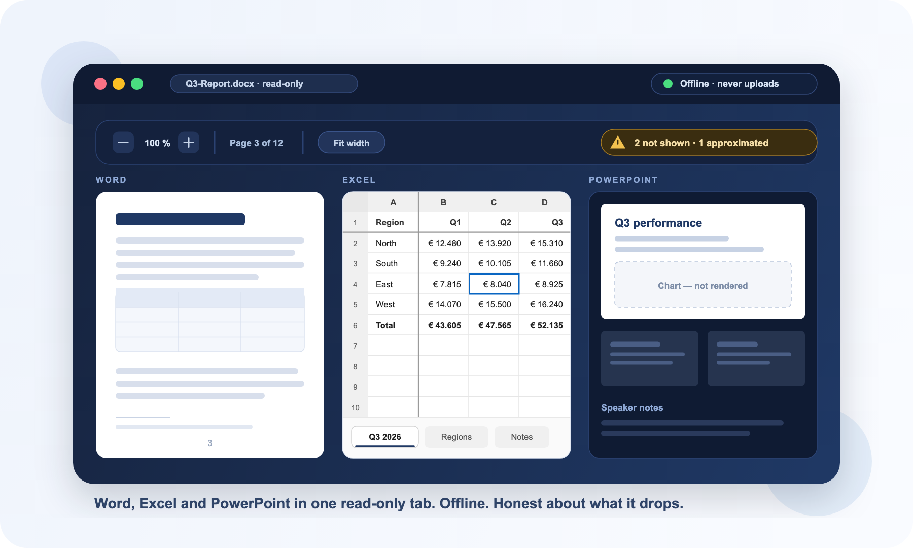

# Concept-LAB Office Viewer

## Read any Office file in VS Code. Without opening Office

A **read-only** VS Code previewer for Microsoft Office files. Open a `.docx`,
`.xlsx`, `.pptx` or `.csv` in the editor and read it without leaving your workspace and
without launching Office.

It never modifies the file it opens, and the webview never reaches the network
— everything third-party ships vendored inside the extension.

> **Status: working, v0.3.0.** Word, Excel and PowerPoint all render.
> `npm run package` builds an installable VSIX. Every row
> in the table below is backed by a generated fixture and a smoke assertion —
> "Verified" means `npm run test:smoke` proves it, not that someone looked once.

## Why teams use it

- Open `.docx`, `.xlsx`, `.pptx` and `.csv` in a tab you already have open
- Read a document laid out by a real Office-compatible engine, not an approximation
- Scroll a workbook with its frozen panes, merged cells and number formats intact
- See exactly what the viewer could not draw, on the slide and in the report
- Stay offline — nothing about your file ever leaves the machine
- Keep the file untouched; one click hands it to Office when you need to edit

## Two rendering modes

| | `exact` (default) | `native` |
| --- | --- | --- |
| Applies to | Word and PowerPoint | Word and PowerPoint |
| How | A locally installed LibreOffice converts the file to PDF; pdf.js draws it | Built-in HTML renderers |
| Fidelity | What a real Office-compatible layout engine produced | An approximation |
| Needs | LibreOffice on the machine | Nothing |
| First open | The built-in render immediately, the exact one a few seconds later and cached from then on | Instant |

`exact` is the default and falls back to `native` automatically when
LibreOffice is not installed. Nothing is uploaded in either mode — the
conversion runs on your machine, so the offline guarantee holds. LibreOffice is
detected, never bundled, so its licence does not apply to this product.

Switch with `conceptLabOfficeViewer.fidelity`.

**Spreadsheets ignore this setting.** Converting a workbook to PDF gives you
its *print* layout — the sheet cut into paper-sized pieces, with no sheet tabs,
no frozen panes and no grid. That is not how Excel opens the file, so `.xlsx`,
`.xlsm`, `.xlsb`, `.xls` and `.csv` always get the live scrollable grid.

## What it opens

Fidelity is stated honestly. An Office viewer that renders most of a document
and silently drops the rest is worse than one that says what it dropped, so
this table is part of the product rather than marketing copy.

| Format | Renders | Does **not** render | Status |
| --- | --- | --- | --- |
| `.docx`, `.dotx` | Text, styles, tables (incl. vertical merges), images, headers/footers, lists and numbering, footnotes, hyperlinks, explicit page breaks | Computed field results such as a table of contents or page numbers, DrawingML charts, SmartArt. Pages are reflowed from the file's page size; Word's widow/orphan and keep-with-next rules are not applied, so a long document can differ by a page | **Verified** |
| `.docm` | As `.docx` | Macros are never executed — their presence is disclosed | **Verified** |
| `.xlsx`, `.xlsm` | Cell values, number formats, fonts, fills, borders, alignment, merged cells (row *and* column), frozen panes, column widths, multiple sheets | Charts, images, pivot tables, conditional formatting, data validation | **Verified** |
| `.xls`, `.xlsb` | Cell values and number formats | Styling — the legacy parser does not expose it | **Verified** (`.xls`) |
| `.csv` | Values, quoted delimiters, escaped quotes | Nothing to drop | **Verified** |
| `.pptx`, `.pptm`, `.ppsx`, `.potx` | Slide order, theme colours, placeholder geometry inherited from layout and master, text with size/weight/colour, bulleted levels, images, tables with merged cells, master furniture, speaker notes | Charts, SmartArt, embedded objects, audio and video, animations and transitions | **Verified** |

Anything the viewer cannot represent is reported in the document itself, not
hidden. Charts, SmartArt, embedded objects, substituted fonts, formulas with no
cached result and refused external references each produce a visible entry.

### PowerPoint

Rendered by a hand-written renderer, because no admissible library exists —
`pptx-preview` needs a bundler and five shims including echarts, and
`@silurus/ooxml` is a 12 MB pre-1.0 package. The full assessment is in
the dependency policy.

A slide is a shape tree with absolute EMU geometry, so positions, sizes, theme
colours and placeholder inheritance are computed exactly rather than
approximated. What cannot be drawn — charts, SmartArt, embedded media — appears
as a labelled placeholder on the slide *and* in the fidelity panel, so an
incomplete slide is never mistaken for a complete one.

Legacy binary `.ppt` is not supported; opening one explains why and offers to
open it in PowerPoint.

## What it is not

Deliberate non-goals: editing, conversion, export, printing, macro execution,
Explorer thumbnails, and anything that would require a build step in the
webview.

The only write path to your document is your own copy of Office, reached
through the "open in system viewer" action.

## Why offline matters here

A viewer that fetches fonts or stencils from a CDN when you open a document is
unusable in a locked-down or air-gapped workspace, and is a quiet data leak
everywhere else.

Office files make this harder than it looks: a `.docx` image can be a URL
rather than an embedded part, a `.xlsx` can carry external workbook links, and a
`.pptx` can reference remote media. Those URLs come out of *your* file, so no
static check can see them. Every renderer refuses to resolve them, and the test
suite fails the build if the webview issues a single request outside the local
fixture server.

## Architecture

Two halves, **no bundler on either side**.

- Extension host: TypeScript, plain `tsc` to `dist/`, module Node16.
- Webview: plain ES modules loaded over `asWebviewUri`, no build step.

What you edit is what runs. This is a load-bearing property, not a preference —
it is why the diff stays reviewable against the running extension, and it is
why several otherwise-better libraries were rejected.

The spreadsheet grid is hand-written, because every mature JavaScript
spreadsheet grid is either licence-blocked, archived, stale, or requires a
bundler. The reasoning is recorded in full in the dependency policy.

---

This repository exists so the pictures in the extension's listing resolve from a
public URL. The extension itself — source, tests and build — lives in a private
repository; nothing here is the product.

Copyright (c) 2026 Concept-LAB BV. All rights reserved. Proprietary software; see `LICENSE.txt`.
